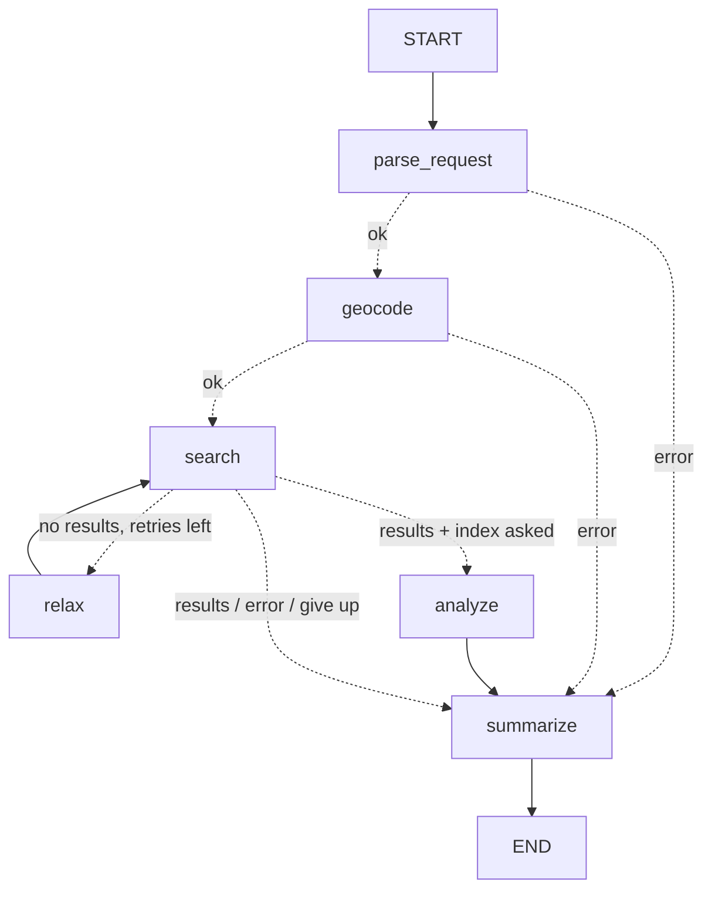

# eo-stac-agent

Ask for satellite imagery in plain language; a LangGraph agent turns it into a STAC
catalog search, relaxes the search if nothing matches, and returns the best products.
Ask an analysis question and it also reads the pixels, computes NDVI/NDWI and its change,
and writes a map plus a provenance record.

```
> Sentinel-2 over Toulouse in July 2025 with less than 10% cloud
  [parse_request] {"place":"Toulouse, France","collection":"sentinel-2-l2a",...,"max_cloud_cover":10.0}
  [geocode] bbox=[1.35, 43.533, 1.515, 43.669]
  [search] attempt 1: 0 result(s)
  [relax] max cloud cover 10% -> 30%
  [search] attempt 2: 0 result(s)
  [relax] max cloud cover 30% -> 50%
  [search] attempt 3: 3 result(s)
  [summarize] done
```

## Graph



| Node | Course concept |
|---|---|
| `parse_request` | Structured output (`with_structured_output` + Pydantic) |
| `geocode`, `search` | Plain-Python tool nodes (Nominatim, `pystac-client`) |
| `route_after_*` | Conditional edges |
| `relax` → `search` | Cycles / retry loop with a bounded attempt counter |
| `analyze` | Deterministic processing tool; the LLM only interprets its numbers |
| `summarize` | LLM grounded on tool output |

## Analysis questions

```
> How did vegetation around Dakar change between July and September 2025?
  [parse_request] {...,"index":"ndvi","start_date":"2025-09-01",...,"baseline_start_date":"2025-07-01",...}
  [search] attempt 1: 5 result(s), baseline 5
  [analyze] NDVI mean: target 0.309 (59% clear), baseline 0.202 (71% clear), change +0.095 -> outputs\...\provenance.json
```

`analysis.py`, Sentinel-2 only (Earth Search's Landsat is in a requester-pays bucket):

- **Reads only the area**: each band's window is read from the COG and warped onto one EPSG:4326 grid
  (≤1024 px, never finer than 10 m), so scenes from different tiles/UTM zones line up pixel by pixel.
- **Masks what can't be trusted**: SCL clouds, shadows and cirrus plus a 60 m buffer (SCL misses thin
  cloud edges). For NDVI, water is excluded and reported as a share, otherwise the sea in a coastal
  bounding box shows up as "stable vegetation ~ 0".
- **Picks scenes by coverage over the area, not the tile**: the clearest catalog scene can still be cloudy
  over your city; the next one is tried (up to 3) until ≥50% of the land is clear.
- **States its uncertainty**: clear share per date, days between scenes, sensor differences, missing baseline.
  The LLM may only cite these numbers and may name causes only as hypotheses.
- **Writes** `outputs/<time>_<place>_<index>/analysis.png` (both dates and the change map) and
  `provenance.json` (query, parsed and relaxed request, scene IDs, band hrefs, method, thresholds,
  software versions), enough to audit or recompute the result without the LLM.

## Run

```powershell
pip install -r requirements.txt
copy .env.example .env        # then set OPENAI_API_KEY (or switch LLM_MODEL to Gemini)
python -m eo_stac_agent "Sentinel-2 over Toulouse in July 2025, less than 10% cloud"
python -m eo_stac_agent       # interactive mode (follow-ups; 'new' starts a fresh conversation)
python -m eo_stac_agent --graph
pytest -q                     # offline, no API key needed
```

Interactive mode is one conversation (a LangGraph `thread_id` with an `InMemorySaver` checkpointer), so
follow-ups build on the previous request:

```
> Sentinel-2 over Dakar in July 2025, less than 10% cloud      -> 2 scenes
> same thing but for August                                    -> Dakar, August, <10%: 1 scene
> what about Landsat?                                          -> Dakar, August, Landsat (relaxed to 30%)
```

Follow-ups start from the request *as you asked it*, not as relaxed: after a search widened to 30% cloud,
"same but August" still asks for 10%.

Supported collections (Earth Search): `sentinel-2-l2a`, `landsat-c2-l2`, `sentinel-1-grd`.
Point `STAC_URL` at any other STAC API (e.g. your internal catalog) to reuse the agent.

## Exercises to go further

1. ~~**Checkpointing + follow-ups**~~: done (see above). Next: swap `InMemorySaver` for `SqliteSaver` so
   conversations survive a restart.
2. **Replay**: `python -m eo_stac_agent --replay outputs/.../provenance.json` recomputes the analysis from
   the recorded scenes and method, with no LLM, and diffs the numbers. Reproducibility made testable.
3. **Composites instead of snapshots**: median NDVI over all clear scenes in each period, to remove the
   "single-scene" caveat.
4. **Human-in-the-loop**: after `search`, `interrupt()` to let the user pick a product, then a
   `download` node fetches the `visual` COG.
5. **LangSmith tracing**: set `LANGSMITH_TRACING=true` and inspect each node's inputs/outputs.
6. **Evaluation**: a dataset of 20 requests → expected `SearchRequest`, scored in CI.
7. **Serve it**: wrap in FastAPI, containerize, deploy with Helm, and swap `LLM_MODEL` for a
   self-hosted model (vLLM/Ollama) if data can't leave your network.
