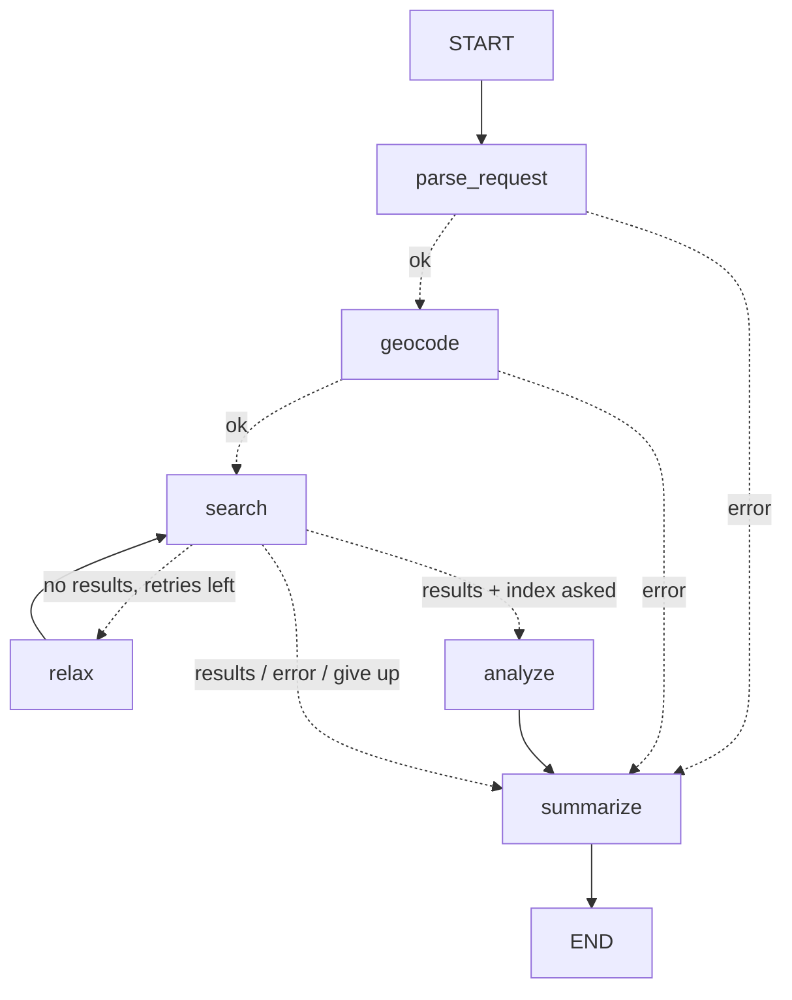

# eo-stac-agent

Ask for satellite imagery in plain language; a LangGraph agent turns it into a STAC
catalog search, relaxes the search if nothing matches, and returns the best products.
Ask an analysis question and it also reads the pixels, computes NDVI/NDWI and its change,
and writes a map plus a provenance record.

```
> Sentinel-2 over Toulouse in July 2025 with less than 10% cloud
  [parse_request] {"place":"Toulouse, France","collection":"sentinel-2-l2a",...,"max_cloud_cover":10.0}
  [geocode] bbox=[1.35, 43.533, 1.515, 43.669]
  [search] attempt 1: 0 result(s)
  [relax] max cloud cover 10% -> 30%
  [search] attempt 2: 0 result(s)
  [relax] max cloud cover 30% -> 50%
  [search] attempt 3: 3 result(s)
  [summarize] done
```

## Graph



| Node | Course concept |
|---|---|
| `parse_request` | Structured output (`with_structured_output` + Pydantic) |
| `geocode`, `search` | Plain-Python tool nodes (Nominatim, `pystac-client`) |
| `route_after_*` | Conditional edges |
| `relax` → `search` | Cycles / retry loop with a bounded attempt counter |
| `analyze` | Deterministic processing tool; the LLM only interprets its numbers |
| `summarize` | LLM grounded on tool output |

## Analysis questions

```
> How did vegetation around Dakar change between July and September 2025?
  [parse_request] {...,"index":"ndvi","start_date":"2025-09-01",...,"baseline_start_date":"2025-07-01",...}
  [search] attempt 1: 5 result(s), baseline 5
  [analyze] NDVI mean: target 0.309 (59% clear), baseline 0.202 (71% clear), change +0.095, different seasons -> outputs\...\provenance.json
```

`analysis.py`, Sentinel-2 only (Earth Search's Landsat is in a requester-pays bucket):

- **Reads only the area**: each band's window is read from the COG and warped onto one EPSG:4326 grid
  (≤1024 px, never finer than 10 m), so scenes from different tiles/UTM zones line up pixel by pixel.
- **Masks what can't be trusted**: SCL clouds, shadows and cirrus plus a 60 m buffer (SCL misses thin
  cloud edges). For NDVI, water is excluded and reported as a share, otherwise the sea in a coastal
  bounding box shows up as "stable vegetation ~ 0".
- **Mosaics each overpass and picks it by coverage over the area, not the tile**: an area often straddles
  Sentinel-2 tile edges, so all tiles of one overpass (same day, same satellite, up to 4) are combined, using
  every search result and not only the top ones shown. The clearest overpass can still be cloudy over your
  city; the next one is tried (up to 3) until ≥50% of the land is clear. Area outside the tiles is reported
  as "not covered", separately from cloud.
- **Names the index exactly**: "NDWI" means two different indices in the literature. This agent computes
  McFeeters' open-water NDWI, (B03 - B08) / (B03 + B08), never Gao's NIR-SWIR vegetation water-content index,
  and says so in the answer, the PNG and `provenance.json`.
- **Checks the dates are comparable**: dates more than 30 days apart in the annual cycle (ignoring the year)
  get a "not seasonally comparable" warning, because the difference then includes normal phenology. July vs
  September in Dakar is mostly rainy-season greening. Same months in different years get a weather caveat instead.
- **Answers water questions in km², not mean NDWI**: water is NDWI > 0 on clear pixels. Change is gained / lost /
  net km² on ground clear on both dates only. Mean NDWI over a box that is mostly land drops when vegetation
  greens, which once made a lake that had *grown* look like it had shrunk. Per-date totals that cover different
  ground are flagged as not comparable.
- **States its uncertainty**: clear share per date, days between scenes, sensor differences, missing baseline.
  The LLM may only cite these numbers and may name causes only as hypotheses.
- **Writes** `outputs/<time>_<place>_<index>/analysis.png` (both dates and the change map) and
  `provenance.json` (query, parsed and relaxed request, scene IDs, band hrefs, method, thresholds,
  software versions), enough to audit or recompute the result without the LLM.

## Run

```powershell
pip install -r requirements.txt
copy .env.example .env        # then set your API key: see Configuration below
python -m eo_stac_agent "Sentinel-2 over Toulouse in July 2025, less than 10% cloud"
python -m eo_stac_agent       # interactive mode (follow-ups; 'new' starts a fresh conversation)
python -m eo_stac_agent --graph
pytest -q                     # offline, no API key needed
```

Interactive mode is one conversation (a LangGraph `thread_id` with an `InMemorySaver` checkpointer), so
follow-ups build on the previous request:

```
> Sentinel-2 over Dakar in July 2025, less than 10% cloud      -> 2 scenes
> same thing but for August                                    -> Dakar, August, <10%: 1 scene
> what about Landsat?                                          -> Dakar, August, Landsat (relaxed to 30%)
```

Follow-ups start from the request *as you asked it*, not as relaxed: after a search widened to 30% cloud,
"same but August" still asks for 10%.

Supported collections (Earth Search): `sentinel-2-l2a`, `landsat-c2-l2`, `sentinel-1-grd`.
Point `STAC_URL` at any other STAC API (e.g. your internal catalog) to reuse the agent.

## Configuration

Settings are read from `.env` (start from `.env.example`). `.env` holds your API keys and is git-ignored:
never commit it.

| Variable | Default | Purpose |
|---|---|---|
| `LLM_MODEL` | `openai:gpt-4.1-mini` | `provider:model` in LangChain `init_chat_model` format, e.g. `google_genai:gemini-3.5-flash` or `openrouter:google/gemini-3.5-flash` |
| `OPENAI_API_KEY` / `GOOGLE_API_KEY` / `OPENROUTER_API_KEY` | none | Key for the provider in `LLM_MODEL` |
| `LLM_TIMEOUT` | `60` | Seconds before an LLM request is abandoned; it is retried once |
| `LLM_REASONING_EFFORT` | `low` for Gemini, unset otherwise | `low` / `medium` / `high`. Parsing and summarizing need little reasoning, and higher is much slower. Sent to OpenRouter only when set |
| `STAC_URL` | Earth Search | Any STAC API |
| `OUTPUT_DIR` | `outputs` | Where analysis runs write `analysis.png` and `provenance.json` |
| `USE_SYSTEM_CERTS` | `true` | Trust the OS certificate store, needed behind TLS-inspecting corporate proxies |
| `NOMINATIM_URL`, `NOMINATIM_USER_AGENT` | OSM Nominatim | Geocoder; its usage policy requires an identifying User-Agent |

Notes from running it:

- **Variables already set in your shell win over `.env`** (`load_dotenv` does not override them). If a
  change in `.env` seems ignored, check `$env:LLM_MODEL` in PowerShell and `Remove-Item Env:LLM_MODEL`.
- **Gemini availability varies by model.** Retired or overloaded models return `404 NOT_FOUND`,
  `503 UNAVAILABLE` or `504 DEADLINE_EXCEEDED`. The agent then ends with a clear message, or with a plain
  results table if only the summary failed. Switching `LLM_MODEL` to another model your key lists
  (`gemini-3.5-flash` worked when the newer flash models were overloaded) usually fixes it.
- Some Gemini models reject `LLM_REASONING_EFFORT=minimal` with `400 INVALID_ARGUMENT`; use `low`.
- **OpenRouter** gives one key for many vendors' models (OpenAI, Google, Anthropic, Mistral, open-weight
  models...), which is handy when one provider is overloaded: switch `LLM_MODEL`, not your key. Model ids
  are `vendor/model` as listed on https://openrouter.ai/models. Choose one that supports **tool calling**,
  because `parse_request` relies on it for structured output.

## Exercises to go further

1. ~~**Checkpointing + follow-ups**~~: done (see above). Next: swap `InMemorySaver` for `SqliteSaver` so
   conversations survive a restart.
2. **Replay**: `python -m eo_stac_agent --replay outputs/.../provenance.json` recomputes the analysis from
   the recorded scenes and method, with no LLM, and diffs the numbers. Reproducibility made testable.
3. **Composites instead of snapshots**: median NDVI over all clear scenes in each period, to remove the
   "single-scene" caveat.
4. **Human-in-the-loop**: after `search`, `interrupt()` to let the user pick a product, then a
   `download` node fetches the `visual` COG.
5. **LangSmith tracing**: set `LANGSMITH_TRACING=true` and inspect each node's inputs/outputs.
6. **Evaluation**: a dataset of 20 requests → expected `SearchRequest`, scored in CI.
7. **Serve it**: wrap in FastAPI, containerize, deploy with Helm, and swap `LLM_MODEL` for a
   self-hosted model (vLLM/Ollama) if data can't leave your network.
