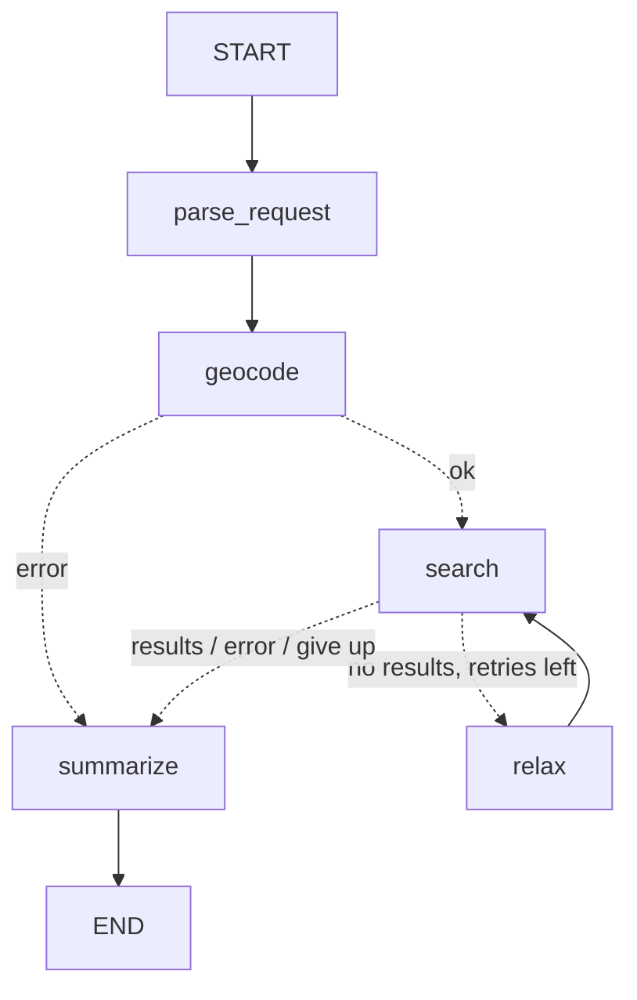

# eo-stac-agent

Ask for satellite imagery in plain language; a LangGraph agent turns it into a STAC
catalog search, relaxes the search if nothing matches, and returns the best products.

```
> Sentinel-2 over Toulouse in July 2025 with less than 10% cloud
  [parse_request] {"place":"Toulouse, France","collection":"sentinel-2-l2a",...,"max_cloud_cover":10.0}
  [geocode] bbox=[1.35, 43.533, 1.515, 43.669]
  [search] attempt 1: 0 result(s)
  [relax] max cloud cover 10% -> 30%
  [search] attempt 2: 0 result(s)
  [relax] max cloud cover 30% -> 50%
  [search] attempt 3: 3 result(s)
  [summarize] done
```

## Graph



| Node | Course concept |
|---|---|
| `parse_request` | Structured output (`with_structured_output` + Pydantic) |
| `geocode`, `search` | Plain-Python tool nodes (Nominatim, `pystac-client`) |
| `route_after_*` | Conditional edges |
| `relax` → `search` | Cycles / retry loop with a bounded attempt counter |
| `summarize` | LLM grounded on tool output |

## Run

```powershell
pip install -r requirements.txt
copy .env.example .env        # then set OPENAI_API_KEY (or switch LLM_MODEL to Gemini)
python -m eo_stac_agent "Sentinel-2 over Toulouse in July 2025, less than 10% cloud"
python -m eo_stac_agent       # interactive mode
python -m eo_stac_agent --graph
pytest -q                     # offline, no API key needed
```

Supported collections (Earth Search): `sentinel-2-l2a`, `landsat-c2-l2`, `sentinel-1-grd`.
Point `STAC_URL` at any other STAC API (e.g. your internal catalog) to reuse the agent.

## Exercises to go further

1. **Checkpointing + follow-ups**: compile with `InMemorySaver`, keep `messages` in state, and support
   "same thing but for August" in the same `thread_id`.
2. **Human-in-the-loop**: after `search`, `interrupt()` to let the user pick a product, then a
   `download` node fetches the `visual` COG.
3. **LangSmith tracing**: set `LANGSMITH_TRACING=true` and inspect each node's inputs/outputs.
4. **Evaluation**: a dataset of 20 requests → expected `SearchRequest`, scored in CI.
5. **Serve it**: wrap in FastAPI, containerize, deploy with Helm, and swap `LLM_MODEL` for a
   self-hosted model (vLLM/Ollama) if data can't leave your network.
